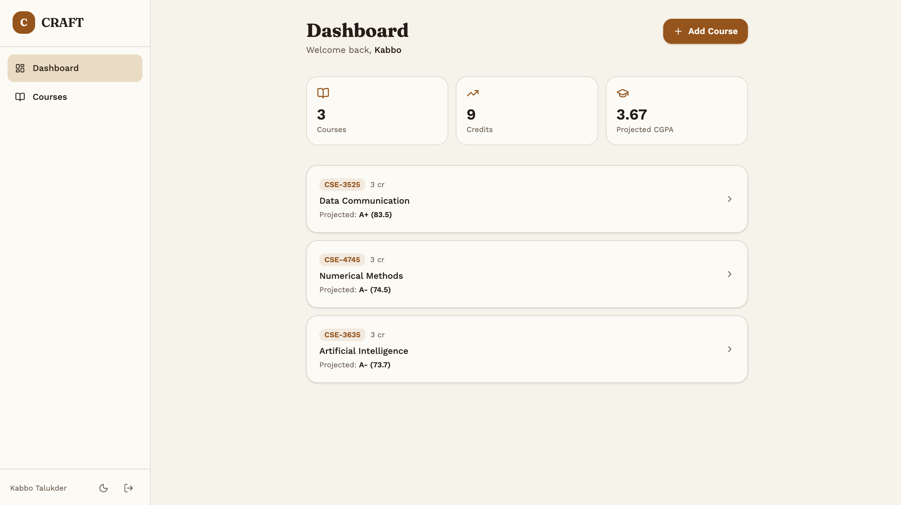
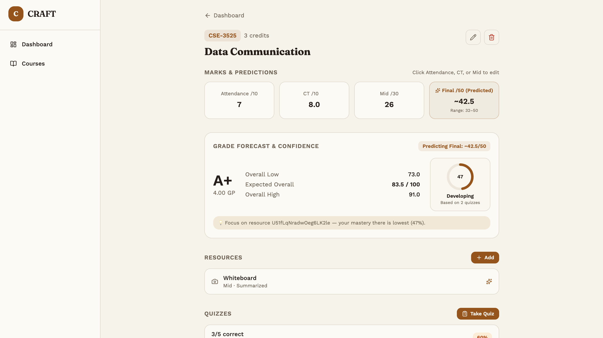
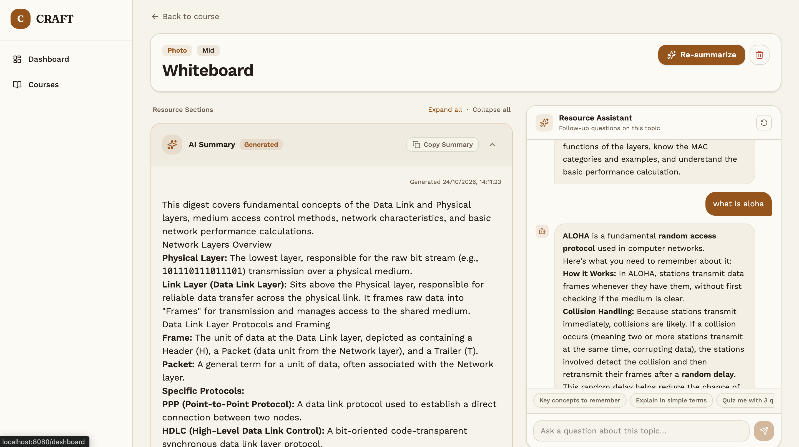

# Craft

An AI-powered academic performance copilot that helps university students track continuous marks, summarize study materials, test knowledge with generated quizzes, and forecast final grades with confidence.

## The problem

University students struggle with fragmented academic tracking and exam uncertainty. Continuous assessment scores (attendance, class tests, and midterms) are scattered across disparate portals and paper notes, leaving students guessing what score they actually need on their final exam to reach their target GPA. When revising, they drown in disorganized lecture slides and whiteboard photos, passively re-reading materials without active recall tools, and enter high-stakes finals with no objective measure of their topic readiness.

## The solution

Craft centralizes course mark tracking and pairs it with an intelligent study pipeline. Students log attendance, class test marks (with flexible multi-test averaging), and midterms, while uploading lecture notes or whiteboard photos for instant AI summarization and OCR text extraction. The platform automatically generates targeted multiple-choice quizzes from these study resources to reinforce retention and evaluate per-resource mastery. Based on continuous assessments and quiz performance, Craft forecasts the student's expected final exam score and overall letter grade alongside a transparent confidence score.

## How it works

- **Model(s) used:**
  - gemma-4-31b-it default via Ollama API for multimodal photo OCR, structured study digests, quiz generation, and in-resource follow-up tutoring).
  - Swappable provider architecture supporting any OpenAI-compatible API endpoint (Ollama, OpenRouter, or vLLM) via `AI_BASE_URL`.
- **Tech stack:**
  - **Frontend**: React 19, [TanStack Start](https://tanstack.com/start) (Full-stack SSR / Server Functions), [TanStack Router](https://tanstack.com/router), [Tailwind CSS v4](https://tailwindcss.com/), Radix UI, Lucide Icons, KaTeX (math rendering).
  - **Backend**: TanStack Start Server Functions, [Firebase Auth](https://firebase.google.com/docs/auth), [Cloud Firestore](https://firebase.google.com/docs/firestore), Firebase Storage.
  - **Tools & Testing**: [Vite](https://vitejs.dev/), [Vitest](https://vitest.dev/), TypeScript, Zod.
- **Datasets (if any):**
  - None (Zero-shot inference on user-provided course notes and uploaded photos; uses standard 4.0 grading scale and weighted continuous assessment: Attendance 10, CT 10, Mid 30, Final 50).

## How to run it

1. **Clone the repo**
   ```bash
   git clone https://github.com/your-username/craft.git
   cd craft
   ```

2. **Install requirements**
   ```bash
   npm install
   ```
   Copy the example environment configuration and fill in your Firebase and AI credentials:
   ```bash
   cp .env.example .env
   ```
   Required environment variables in `.env`:
   - `AI_API_KEY`: Your Google AI Studio API key
   - `AI_MODEL`: `gemini-2.5-flash`
   - `VITE_FIREBASE_*`: Firebase project credentials (API Key, Auth Domain, Project ID, etc.)

3. **Run the app**
   ```bash
   npm run dev
   ```
   Open [http://localhost:8080](http://localhost:8080) in your browser.

   To run the test suite:
   ```bash
   npm test
   ```

## Screenshots / demo

### 1. Dashboard & Projected CGPA
Course overview cards with projected grades, credits, and semester GPA tracking.



### 2. Marks, Predictions & Confidence Score
Class test (CT) and attendance logging with real-time final exam prediction and quiz confidence ring.



### 3. Study Resource Digest & Interactive AI Assistant
Expandable AI summary accordion alongside the real-time AI study assistant for follow-up questions.



## What's not done yet

- **Direct PDF/PPTX parsing**: Currently relies on rich text input and photo uploads (PNG, JPG) for OCR extraction. Direct slide deck document parsing is planned.
- **Offline quiz sync**: If the network disconnects mid-quiz, attempts are submitted upon reconnecting; full offline-first IndexedDB caching is in progress.
- **Semester export/import**: Data export (CSV / JSON) for sharing course outlines and grade archives.

## Credits

- [TanStack Start](https://tanstack.com/start) & [TanStack Router](https://tanstack.com/router) for the type-safe full-stack React framework.
- [Google AI Studio](https://ai.google.dev/) for the Gemma 4 API.
- [Firebase](https://firebase.google.com/) for authentication and Cloud Firestore real-time database.
- [Tailwind CSS](https://tailwindcss.com/) & [Radix UI](https://www.radix-ui.com/) for styling and accessible UI components.
- [Lucide Icons](https://lucide.dev/) for UI icons.
- [KaTeX](https://katex.org/) for LaTeX math typesetting.
- [Sonner](https://sonner.emilkowal.ski/) for toast notifications.
